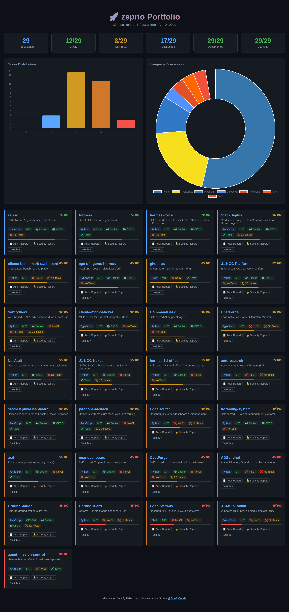
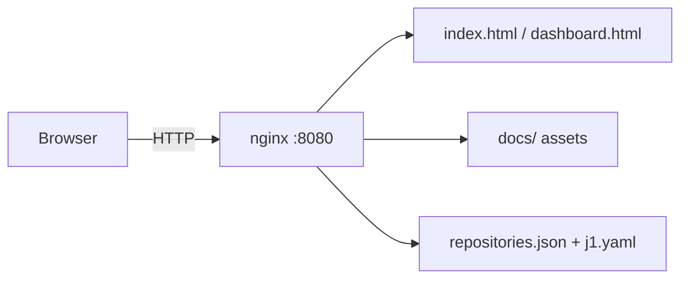

<div align="center">


# zeprio

**Portfolio hub for the OneByJorah organization — repository health, standardization status, and quick links in one static dashboard.**

*Formerly PrimeHub.*

[](https://github.com/OneByJorah/zeprio/actions/workflows/ci.yml)
[](https://github.com/OneByJorah/zeprio/releases)
[](https://ghcr.io/onebyjorah/zeprio)
[](https://opensource.org/licenses/MIT)



</div>

## Why this exists

zeprio is the single landing page for the OneByJorah GitHub organization. It shows all 29 repositories, their health scores, language mix, and links to audit and security reports. The site is generated as a static HTML dashboard, packaged into a small container, and served by nginx. No runtime database or secrets are required.

## Features

- **Organization overview** — counts for repositories, CI coverage, tests, Dockerization, documentation, and licensing.
- **Score distribution** — bar chart of repository grades.
- **Language breakdown** — doughnut chart of primary languages across the portfolio.
- **Per-repository cards** — grade, score, language, license, Docker/CI/test flags, open issues, and direct links.
- **Self-hosted in one command** — runs anywhere Docker Compose is available.
- **No real data required** — the dashboard ships with a seeded, public dataset.

## Quick start

The stack binds to `127.0.0.1` only. The default port is `8080`; override with the `PORT` environment variable.

```bash
git clone https://github.com/OneByJorah/zeprio.git
cd zeprio
PORT=8080 docker compose up -d --build
```

Wait for the container to become healthy, then open:

```bash
curl -s -o /dev/null -w "%{http_code}\n" http://127.0.0.1:8080/
```

You should see `200`. Then open `http://127.0.0.1:8080` in a browser.

To stop:

```bash
docker compose down -v
```

## Configuration

| Variable | Default | Purpose |
| --- | --- | --- |
| `PORT` | `8080` | Host port the container binds to on `127.0.0.1`. |

No secrets or runtime credentials are required. Copy `.env.example` to `.env` if your tooling expects the file, but all values are optional.

## Architecture



The container runs as the unprivileged `nginx` user, drops all capabilities, and enables `no-new-privileges`. Static assets are copied at build time, so the image has no runtime dependencies on the repository checkout.

## Screenshots

All screenshots are captured from the running local stack with Playwright and scrubbed for private IPs, emails, and internal domains before being committed.

| Screen | File |
| --- | --- |
| Portfolio dashboard | [`docs/screenshots/dashboard.png`](docs/screenshots/dashboard.png) |

## Roadmap

- Automate repository data refresh from the GitHub API.
- Add dark/light theme toggle.
- Publish the container image on every release via GitHub Actions.

## Contributing

[Open an issue](https://github.com/OneByJorah/zeprio/issues) to report a bug or request a feature. Pull requests should target a feature branch; never push directly to `main`.

## Security

See [SECURITY.md](SECURITY.md). The container image is scanned for HIGH and CRITICAL vulnerabilities before publishing. No secrets, private IPs, or internal hostnames are committed to this repository.

## License

MIT — see [LICENSE](LICENSE).
